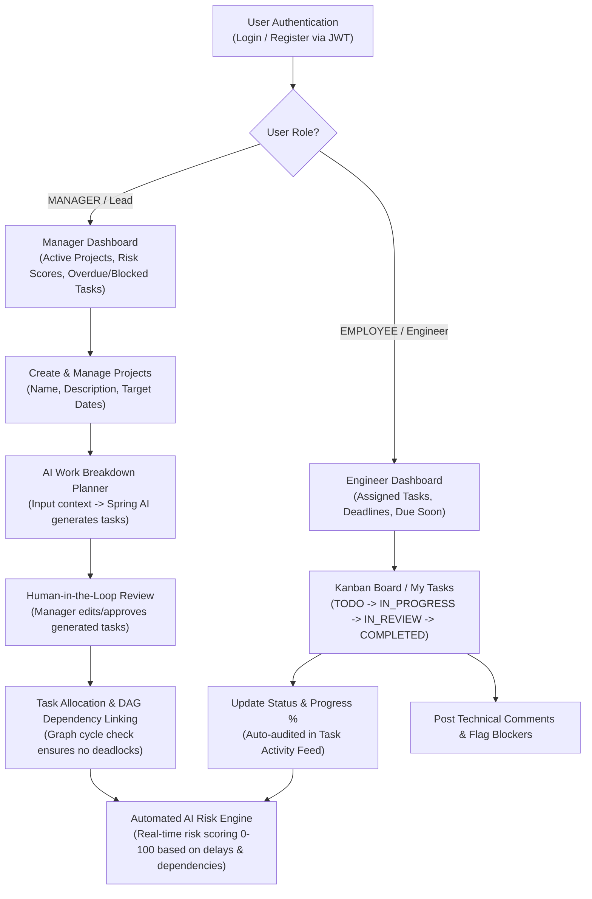
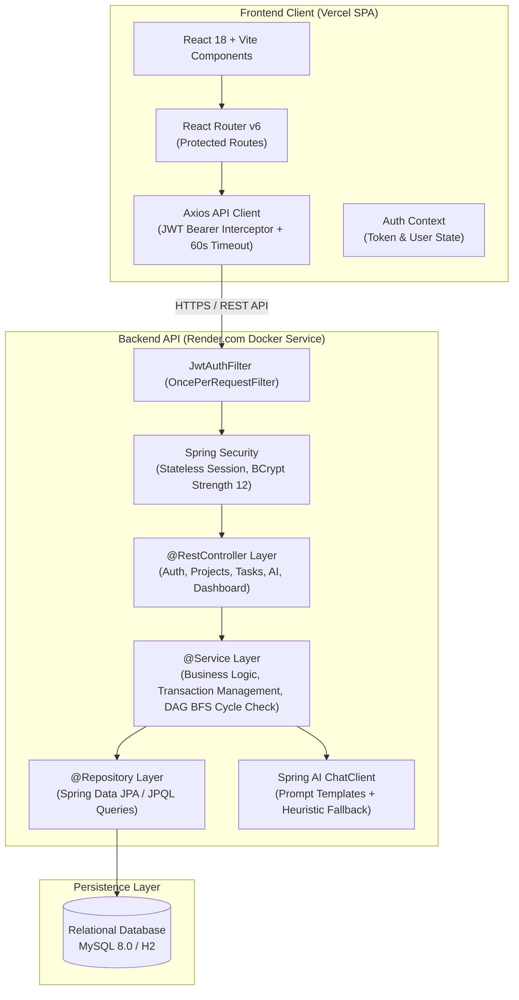
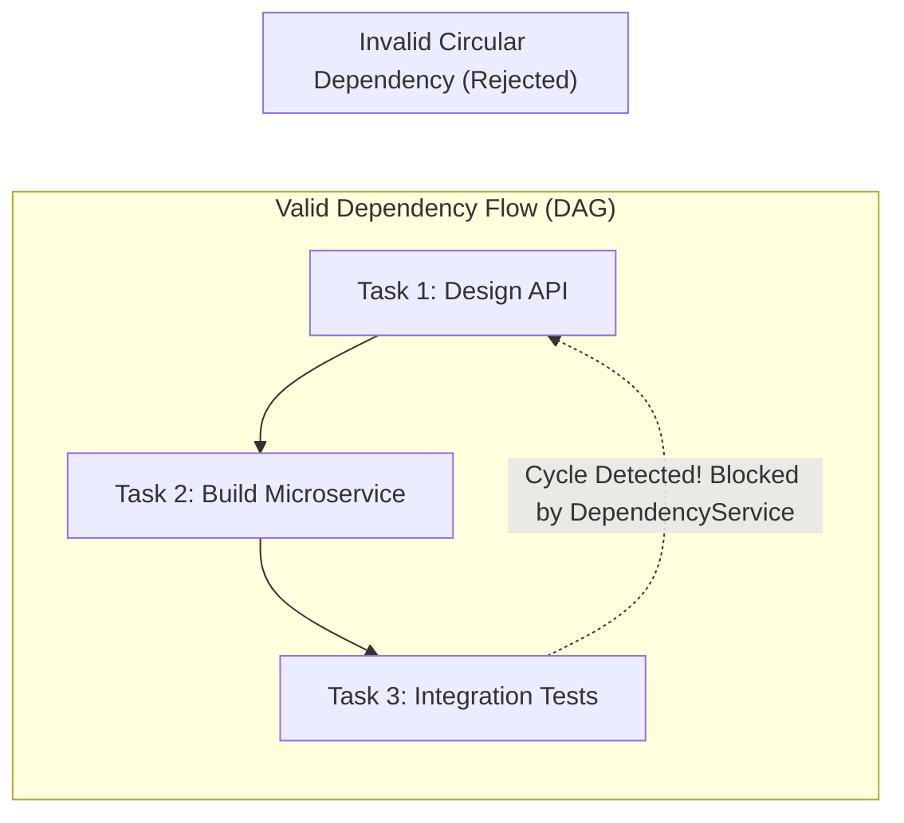
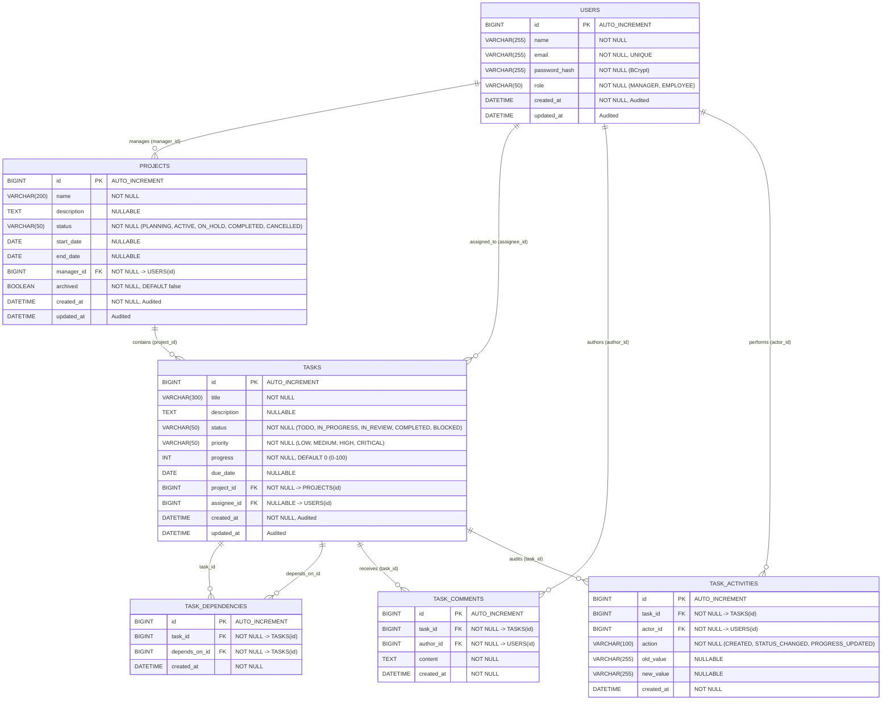

# TaskFlow: Comprehensive System Architecture, Database Schema & Operational Guide

> **Official Project Documentation for TaskFlow**  
> An enterprise-grade, information-dense SaaS platform for agile software engineering teams.  
> Built with **Spring Boot 3.3.4 (Java 21 LTS)**, **React 18 + Vite + TypeScript**, **Tailwind CSS**, and **Spring AI**.

---

## 1. Executive Summary & Working Flow (System Kaise Kaam Karta Hai)

TaskFlow is designed to solve the friction and overhead engineering teams face when tracking deliverables, dependencies, and project risks. Inspired by the speed and density of modern developer tools like **Linear** and **Jira**, TaskFlow eliminates decorative bloat in favor of sub-second responsiveness, clear typography, and rock-solid architectural constraints.

### 1.1 End-to-End System Workflow



### 1.2 Role-Based Access Control (RBAC) Matrix

| Capability / Action | Engineering Lead (`MANAGER`) | Product Engineer (`EMPLOYEE`) |
|---|:---:|:---:|
| **Sign In & View Profile** | Yes | Yes |
| **View Projects & Tasks** | Yes (All) | Yes (All) |
| **Create / Edit / Archive Projects** | **Yes** | Read-Only |
| **Create New Tasks** | **Yes** | No |
| **Assign / Reassign Tasks** | **Yes** | No |
| **Update Task Status (TODO, IN_PROGRESS, etc.)** | Yes | Yes (Assigned tasks) |
| **Update Progress Percentage (0-100%)** | Yes | Yes (Assigned tasks) |
| **Manage Task Dependencies (DAG Links)** | **Yes** | Read-Only |
| **Post Comments on Tasks** | Yes | Yes |
| **Trigger AI Work Breakdown Planner** | **Yes** | No |
| **Approve & Commit AI-Generated Tasks** | **Yes** | No |
| **Run AI Risk Analysis & Executive Summaries** | Yes | Yes |
| **Generate Implementation Plan for a Task** | Yes | Yes |

---

## 2. System Architecture

The project follows a clean **Decoupled Client-Server Monolith Architecture**:
- **Frontend SPA**: React 18, Vite 5, TypeScript 5, Tailwind CSS, deployed on **Vercel**.
- **Backend API**: Spring Boot 3.3.4, Java 21 LTS, modular package design, deployed as a Docker container on **Render.com**.
- **Database**: Relational persistence via **Spring Data JPA & Hibernate** (H2 in-memory profile for zero-config local/demo; MySQL 8.0 for production).
- **AI Engine**: Spring AI with Google Gemini 1.5 Flash (and OpenAI compatibility) with deterministic heuristic fallback.



### 2.1 Frontend Architecture
- **State Management**: React Context (`AuthContext`) manages user authentication state, token storage (`localStorage`), and user roles.
- **Routing**: `react-router-dom` v6 with declarative `ProtectedRoute` components that verify JWT tokens and roles before rendering routes.
- **API Interceptors**: Single configured Axios instance (`frontend/src/api/client.ts`) that automatically appends `Authorization: Bearer <token>` to all outbound requests and handles global 401 Unauthorized redirects.
- **Cold-Start Resilience**: Free-tier cloud instances (like Render) spin down during inactivity; client timeout is set to `60000ms` (60 seconds) to avoid premature timeout errors during cold starts.

### 2.2 Backend Architecture & Package Structure
```text
com.taskflow
├── config/         # SecurityConfig, CorsConfig, JwtProperties, DataInitializer, SwaggerOpenApi
├── security/       # JwtUtil, JwtAuthFilter, UserDetailsServiceImpl
├── auth/           # AuthController, AuthService, RegisterRequest, LoginRequest, AuthResponse
├── user/           # User (Entity), UserRepository, UserService, UserController
├── project/        # Project (Entity), ProjectRepository, ProjectService, ProjectController, DTOs
├── task/           # Task (Entity), TaskRepository, TaskService, TaskController, DTOs
├── dependency/     # TaskDependency (Entity), TaskDependencyRepository, DependencyService (DAG)
├── comment/        # TaskComment (Entity), TaskCommentRepository, CommentService, CommentController
├── activity/       # TaskActivity (Entity), TaskActivityRepository, ActivityController
├── dashboard/      # DashboardService, DashboardController, ManagerDashboardDto, EmployeeDashboardDto
├── ai/             # AiService, AiController, AiTaskPlanResponse, AiRiskResponse, HeuristicFallback
└── exception/      # GlobalExceptionHandler, standardized ApiResponse<T> wrapper
```

### 2.3 Directed Acyclic Graph (DAG) Dependency Engine
To ensure that projects never encounter cyclic task deadlocks (e.g., Task A depends on Task B, which depends on Task A):
1. When a manager requests adding a dependency `taskId -> dependsOnId`, `DependencyService` runs a **graph cycle check** using Breadth-First Search (BFS).
2. It explores whether `dependsOnId` can already reach `taskId` through any chain of existing dependencies.
3. If a circular path is discovered, the request is rejected with `400 Bad Request` and message: *"Adding this dependency would create a circular dependency"*.



### 2.4 AI Engine Architecture
TaskFlow integrates Spring AI with a reliable dual-mode fallback:
1. **Primary Mode (LLM Provider)**: Sends structured Markdown prompt templates to Google Gemini 1.5 Flash / OpenAI, requesting strictly formatted JSON output.
2. **Heuristic Fallback Engine**: If no API key is configured or the external AI provider is unreachable, the system activates deterministic local heuristic engines that generate realistic domain-specific task breakdowns, risk assessments, and implementation roadmaps. The user experience is 100% resilient.

---

## 3. Database Architecture & Complete Schema

The application uses an enterprise relational model with Referential Integrity, Foreign Key cascading, and automatic timestamp auditing.

### 3.1 Entity Relationship (ER) Diagram



### 3.2 Detailed Database Table Definitions

#### 1. `users` Table
Stores authentication credentials and organizational roles.
- `id` (BIGINT, Primary Key, Auto Increment)
- `name` (VARCHAR, Not Null): Full user name.
- `email` (VARCHAR, Not Null, Unique Index): Unique corporate email address.
- `password_hash` (VARCHAR, Not Null): One-way BCrypt hash with 12 rounds of salt.
- `role` (VARCHAR, Not Null): Enum value: `MANAGER` or `EMPLOYEE`.
- `created_at` / `updated_at`: JPA Audited timestamps.

#### 2. `projects` Table
Represents software initiatives managed by team leads.
- `id` (BIGINT, Primary Key, Auto Increment)
- `name` (VARCHAR, Not Null): Project title.
- `description` (TEXT): High-level architectural specifications and goals.
- `status` (VARCHAR, Not Null): `PLANNING`, `ACTIVE`, `ON_HOLD`, `COMPLETED`, `CANCELLED`.
- `start_date` / `end_date` (DATE): Target release boundaries.
- `manager_id` (BIGINT, Foreign Key -> `users.id`, Not Null): Owner with admin privileges.
- `archived` (BOOLEAN, Default `false`): Soft-delete flag.

#### 3. `tasks` Table
Individual units of engineering work.
- `id` (BIGINT, Primary Key, Auto Increment)
- `title` (VARCHAR, Not Null): Deliverable title.
- `description` (TEXT): Acceptance criteria and implementation notes.
- `status` (VARCHAR, Not Null): `TODO`, `IN_PROGRESS`, `IN_REVIEW`, `COMPLETED`, `BLOCKED`.
- `priority` (VARCHAR, Not Null): `LOW`, `MEDIUM`, `HIGH`, `CRITICAL`.
- `progress` (INT, Not Null, Default 0): Integer between 0 and 100.
- `due_date` (DATE): Sprint deadline.
- `project_id` (BIGINT, Foreign Key -> `projects.id`, Not Null).
- `assignee_id` (BIGINT, Foreign Key -> `users.id`, Nullable): Assigned software engineer.

#### 4. `task_dependencies` Table
Models Directed Acyclic Graph edges between tasks.
- `id` (BIGINT, Primary Key, Auto Increment)
- `task_id` (BIGINT, Foreign Key -> `tasks.id`, Not Null): The dependent task.
- `depends_on_id` (BIGINT, Foreign Key -> `tasks.id`, Not Null): The prerequisite task.
- `created_at` (DATETIME, Not Null)
- *Constraint*: `UNIQUE(task_id, depends_on_id)` prevents duplicate dependency links.

#### 5. `task_comments` Table
Threaded technical discussions on tasks.
- `id` (BIGINT, Primary Key, Auto Increment)
- `task_id` (BIGINT, Foreign Key -> `tasks.id`, Not Null).
- `author_id` (BIGINT, Foreign Key -> `users.id`, Not Null).
- `content` (TEXT, Not Null).
- `created_at` (DATETIME, Not Null).

#### 6. `task_activities` Table
Immutable audit trail tracking state changes.
- `id` (BIGINT, Primary Key, Auto Increment)
- `task_id` (BIGINT, Foreign Key -> `tasks.id`, Not Null).
- `actor_id` (BIGINT, Foreign Key -> `users.id`, Not Null).
- `action` (VARCHAR, Not Null): e.g. `STATUS_CHANGED`, `PROGRESS_UPDATED`, `CREATED`.
- `old_value` / `new_value` (VARCHAR).
- `created_at` (DATETIME, Not Null).

---

## 4. Kisi ko Manager appoint kaise karein? (Comprehensive Operational Guide)

### 4.1 Enterprise Security Principle: Why Sign Up grants `EMPLOYEE` by default

In standard enterprise systems, allowing a public `/register` form to create `MANAGER` or `ADMIN` accounts is a severe security vulnerability (known as **Privilege Escalation**). An external visitor could register and immediately delete production projects, reassign tasks, or access sensitive financial/HR roadmaps.

Therefore, in TaskFlow:
- Any self-registration via the web app automatically receives the **`EMPLOYEE`** role.
- Elevating a user to **`MANAGER`** is an administrative action.

Here are the **three methods** to appoint someone as a Manager:

---

### Method 1: Automatic Startup Seeding in Code (Recommended for Project Owners)

If you want your personal account or a designated team lead to always be a Manager as soon as the backend starts up, configure it directly in [`backend/src/main/java/com/taskflow/config/DataInitializer.java`](file:///d:/Project%201/backend/src/main/java/com/taskflow/config/DataInitializer.java):

```java
// Check if the user already exists to avoid duplicates
if (!userRepository.existsByEmail("your.email@company.com")) {
    userRepository.save(User.builder()
            .name("Gaurav Kumar")
            .email("your.email@company.com")
            .passwordHash(passwordEncoder.encode("YourSecurePassword123!"))
            .role(User.Role.MANAGER)  // <--- Appoints as MANAGER
            .build());
}
```

Whenever the backend restarts (or re-deploys on Render), this user is permanently seeded as a `MANAGER` with full administrative rights.

---

### Method 2: Direct SQL Query in Database

If the user has already registered through the public `/register` page and has an `EMPLOYEE` account in the database, you can elevate them to `MANAGER` with a single SQL query:

#### On Production MySQL / Cloud DB:
```sql
UPDATE users 
SET role = 'MANAGER' 
WHERE email = 'user_email@example.com';
```

#### On Local H2 In-Memory Database:
1. Open your browser and go to `http://localhost:8080/h2-console`.
2. Connect with:
   - **JDBC URL**: `jdbc:h2:mem:taskflow_db`
   - **Username**: `sa`
   - **Password**: *(leave blank)*
3. Run:
   ```sql
   UPDATE users SET role = 'MANAGER' WHERE email = 'user_email@example.com';
   ```
4. Have the user log out and log back in. Their new JWT token will contain `"role": "MANAGER"`.

---

### Method 3: Via Role Promotion API (Future-Ready Team Management)

For organizations that want managers to promote team members directly from the web interface without touching code or database terminals, the following standard endpoint pattern is used:

#### Backend Endpoint in `UserController.java`:
```java
@PatchMapping("/{userId}/promote")
@PreAuthorize("hasRole('MANAGER')") // Only an existing Manager can promote others
public ResponseEntity<ApiResponse<Void>> promoteToManager(
        @PathVariable Long userId,
        @AuthenticationPrincipal UserDetails userDetails) {
    
    User user = userRepository.findById(userId)
            .orElseThrow(() -> new EntityNotFoundException("User not found with id: " + userId));
    
    user.setRole(User.Role.MANAGER);
    userRepository.save(user);
    
    return ResponseEntity.ok(ApiResponse.success("User successfully promoted to Manager", null));
}
```

#### How it works in the UI:
1. A logged-in Engineering Lead navigates to the **Team Directory**.
2. Next to each employee, a **"Promote to Lead / Manager"** button is displayed.
3. Clicking the button calls `PATCH /api/users/{id}/promote`.
4. The employee's role is updated in the database, and on their next login or token refresh, their interface unlocks Manager controls.

---

## 5. Deployment & Production URLs

| Component | Platform | Production Link / Endpoint |
|---|---|---|
| **Frontend Web App** | Vercel | [Live Application](https://ai-powered-project-management-system-git-main-gaurav-1d57.vercel.app) |
| **Backend REST API** | Render | `https://ai-powered-project-management-system-2e5f.onrender.com` |
| **API Base URL** | Render | `https://ai-powered-project-management-system-2e5f.onrender.com/api` |
| **Interactive Swagger Docs** | Render | [Swagger UI](https://ai-powered-project-management-system-2e5f.onrender.com/swagger-ui.html) |
| **GitHub Repository** | GitHub | [GitHub Source Code](https://github.com/Gauravdbg3010/Ai-Powered-Project-Management-System) |

### Demo Credentials

| Role | Name | Email | Password |
|---|---|---|---|
| **Engineering Lead (Manager)** | Sarah Chen | `sarah.chen@taskflow.dev` | `Password123!` |
| **Product Engineer (Employee)** | Marcus Vance | `marcus.vance@taskflow.dev` | `Password123!` |
| **Platform Engineer** | David Miller | `david.miller@taskflow.dev` | `Password123!` |
| **Product Designer** | Elena Rostova | `elena.rostova@taskflow.dev` | `Password123!` |

*(Note: Legacy demo emails `manager@taskflow.com` and `alex@taskflow.com` are retained as aliases for backward compatibility).*
