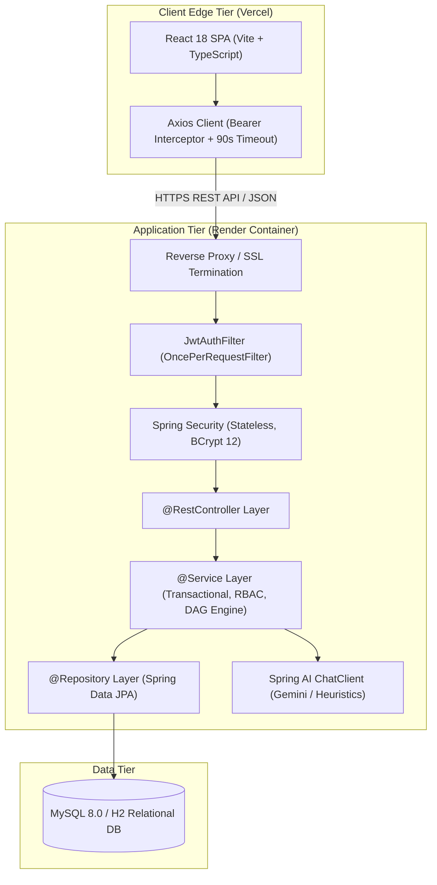
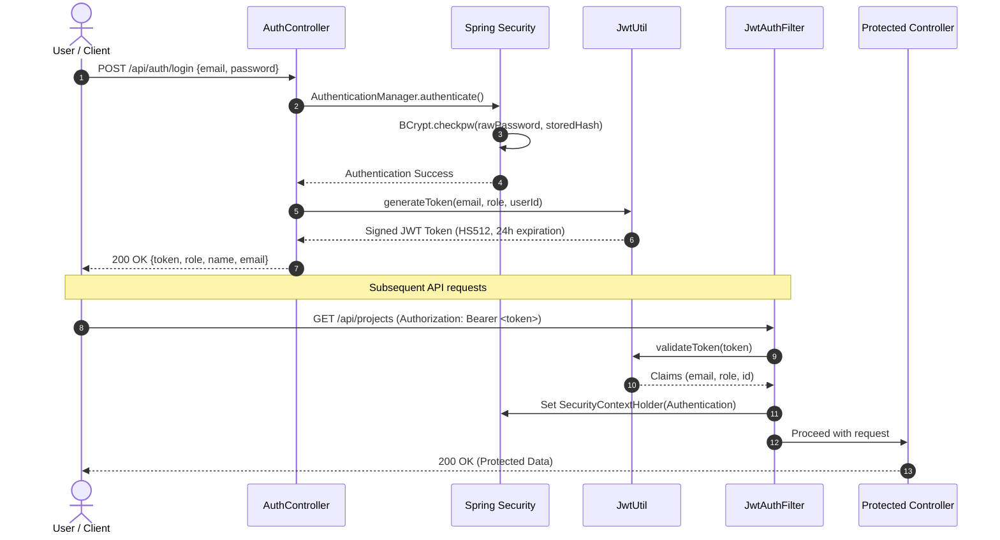
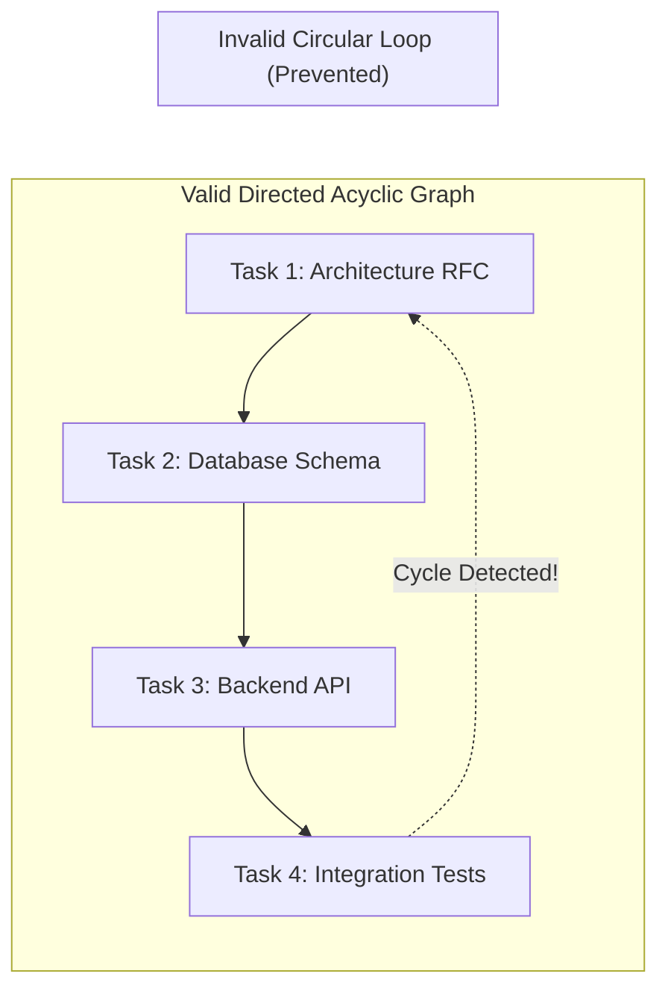
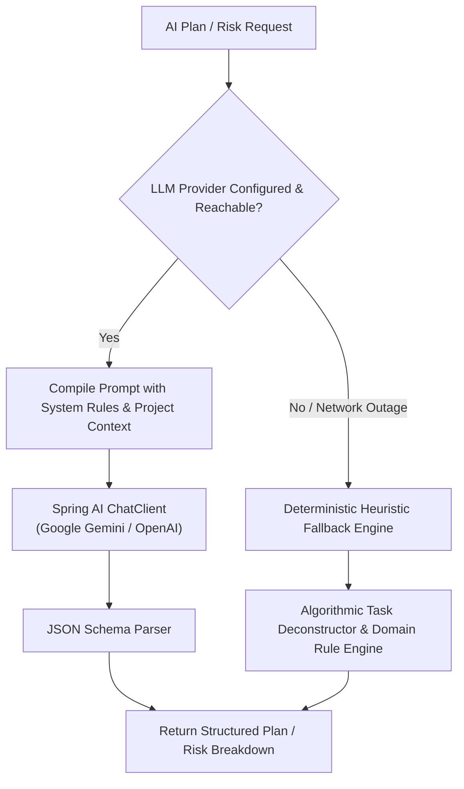

# System Architecture & Technical Design

> Deep-dive architectural specification for **TaskFlow — AI-Powered Project Management System**.  
> Outlining modular design, component topologies, security boundaries, and engineering decisions.

---

## 1. High-Level System Architecture

TaskFlow adopts a **Decoupled Client-Server Monolith Architecture**:
- **Client Tier**: A Single Page Application (SPA) built with React 18, Vite, TypeScript, and Tailwind CSS, deployed at the edge via **Vercel**.
- **Application Tier**: A modular monolith built with Spring Boot 3.3.4 (Java 21 LTS), running as an isolated Docker container on **Render.com**.
- **Persistence Tier**: Relational persistence managed through Spring Data JPA / Hibernate with a dual-profile strategy:
  - `h2`: In-memory database with pre-seeded demo dataset for zero-config development and instant cloud testing.
  - `mysql`: Production-grade MySQL 8.0 instance for permanent enterprise persistence.
- **AI Orchestration Tier**: Spring AI with Google Gemini 1.5 Flash (and OpenAI compatibility), equipped with local heuristic fallback.



---

## 2. Backend Modular Monolith Structure

The backend packages are organized strictly by domain to allow clear isolation, maintainability, and clean separation of concerns:

```text
com.taskflow
├── config/              # Security, CORS, Swagger, and Data Seeding configurations
├── security/            # JWT token creation, validation, and filter chain
├── auth/                # Login, registration, token issuance, and auth DTOs
├── user/                # User entity, repository, and profile management
├── project/             # Project initiatives lifecycle and soft-archiving
├── task/                # Deliverable lifecycle, priorities, and assignments
├── dependency/          # Task dependency DAG and BFS cycle detection logic
├── comment/             # Threaded task discussions and technical updates
├── activity/            # Immutable compliance audit log recording
├── dashboard/           # Manager and Employee operational analytics
├── ai/                  # Spring AI prompt templates, JSON parsers, and fallback heuristics
└── exception/           # Centralized exception translation and unified API envelope
```

### Layer Responsibilities
- **Controller Layer (`@RestController`)**: Handles HTTP transport, path variables, JSON deserialization, and validates request contracts via Jakarta Validation annotations (`@NotBlank`, `@Size`, `@NotNull`).
- **Service Layer (`@Service`)**: Encapsulates business logic, transactional boundaries (`@Transactional`), security checks (`@PreAuthorize`), and audit logging.
- **Repository Layer (`@Repository`)**: Spring Data JPA repositories with derived query methods and custom JPQL queries.

---

## 3. Security & Stateless Authentication Architecture

TaskFlow implements enterprise-grade, stateless token authentication:



### Security Decisions:
1. **Stateless Sessions**: Session creation policy is set to `SessionCreationPolicy.STATELESS`. The backend never stores session state in memory, allowing instant horizontal scaling.
2. **Password Cryptography**: Passwords are saved as one-way cryptographic hashes using BCrypt with a cost factor (strength) of 12.
3. **Role-Based Authorization (RBAC)**: Method-level authorization is enforced with `@PreAuthorize("hasRole('MANAGER')")`. Only managers can create/archive projects, add dependencies, or commit AI plans.
4. **Preflight CORS Handling**: Comprehensive CORS policy configured to allow cross-origin requests from Vercel deployments with full `OPTIONS` preflight support.

---

## 4. Directed Acyclic Graph (DAG) Task Dependencies

Tasks can have prerequisite dependencies (e.g., *API Schema Design* must be completed before *Frontend Client Implementation* can start).



### Cycle Detection Algorithm
To eliminate dangerous dependency deadlocks:
1. Before saving any dependency edge (`Task A depends on Task B`), `DependencyService` runs a **graph cycle detection algorithm** using Breadth-First Search (BFS).
2. It explores whether `Task B` can already reach `Task A` through any sequence of existing dependencies.
3. If a circular path is discovered, the transaction is rejected immediately with a `400 Bad Request` and message: *"Adding this dependency would create a circular dependency"*.

---

## 5. Dual-Mode Spring AI Orchestration

TaskFlow incorporates a robust AI layer that guarantees 100% operational uptime:



1. **System Prompt Enforcement**: The LLM is strictly constrained via system prompt instructions to return well-formed JSON matching the application's DTO contracts.
2. **Deterministic Heuristic Fallback**: If an API key is missing or the external AI provider is unreachable, TaskFlow seamlessly switches to an internal heuristic engine. Projects are broken down logically based on domain rules, preventing app crashes.

---

## 6. Frontend Architecture & Resilience

The React 18 client is designed for high responsiveness and information density:
- **Tailwind Utility Tokens**: 8-point grid, clean typography (`Inter`), and restrained neutral color surfaces (`#f8f9fb`).
- **Axios Interceptor**: Automatically injects Bearer JWT from `localStorage` into all outgoing requests.
- **Cold-Start Resilience**: 90-second timeout (`timeout: 90000`) prevents premature aborts when Render free-tier instances wake up from idle sleep.
