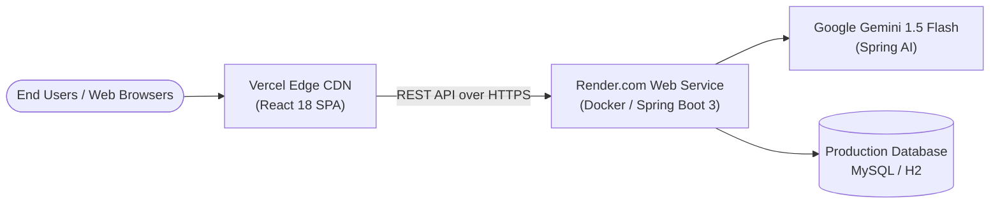

# Production Deployment Guide

> Step-by-step production deployment guide for **TaskFlow — AI-Powered Project Management System**.  
> Deploying the Spring Boot backend on **Render.com** (Docker) and the React SPA on **Vercel**.

---

## 1. Production Architecture Overview



| Component | Platform | URL |
|---|---|---|
| **Frontend Web App** | Vercel | [https://ai-powered-project-management-system-git-main-gaurav-1d57.vercel.app](https://ai-powered-project-management-system-git-main-gaurav-1d57.vercel.app) |
| **Backend REST API** | Render | `https://ai-powered-project-management-system-2e5f.onrender.com` |
| **Swagger UI** | Render | [https://ai-powered-project-management-system-2e5f.onrender.com/swagger-ui.html](https://ai-powered-project-management-system-2e5f.onrender.com/swagger-ui.html) |
| **Source Repository** | GitHub | [Gauravdbg3010/Ai-Powered-Project-Management-System](https://github.com/Gauravdbg3010/Ai-Powered-Project-Management-System) |

---

## 2. Deploying the Backend on Render.com

### Step 1: Create a Web Service
1. Log in to [Render.com](https://render.com).
2. Click **New +** > **Web Service**.
3. Connect your GitHub repository: `Gauravdbg3010/Ai-Powered-Project-Management-System`.
4. Configure service settings:
   - **Name**: `ai-powered-project-management-system-2e5f` (or your preferred name)
   - **Region**: Singapore / Frankfurt / Oregon (nearest to your audience)
   - **Branch**: `main`
   - **Root Directory**: `backend`
   - **Environment**: `Docker`

### Step 2: Configure Environment Variables on Render
Under **Environment Variables**, add:

| Key | Example Value | Description |
|---|---|---|
| `PORT` | `8080` | Port on which Spring Boot listens |
| `SPRING_PROFILES_ACTIVE` | `h2` *(or `mysql`)* | Active database profile |
| `TASKFLOW_JWT_SECRET` | `404E635266556A586E3272357538782F413F4428472B4B6250645367566B5970` | 256-bit or 512-bit hex secret |
| `TASKFLOW_JWT_EXPIRATION` | `86400000` | Token validity in milliseconds (24 hours) |
| `SPRING_AI_GEMINI_API_KEY` | *(optional)* | Google Gemini API key for live AI |

### Step 3: Dockerfile Validation
TaskFlow includes a production multi-stage [`backend/Dockerfile`](file:///d:/Project%201/backend/Dockerfile):
- Stage 1: Builds the Spring Boot fat JAR with Maven.
- Stage 2: Packages the JAR into a lightweight, secure Eclipse Temurin JRE 21 Alpine image.

Render automatically builds and starts the container.

---

## 3. Deploying the Frontend on Vercel

### Step 1: Import Project to Vercel
1. Log in to [Vercel.com](https://vercel.com).
2. Click **Add New...** > **Project**.
3. Import your repository: `Gauravdbg3010/Ai-Powered-Project-Management-System`.
4. Configure project settings:
   - **Framework Preset**: `Vite`
   - **Root Directory**: `frontend`
   - **Build Command**: `npm run build`
   - **Output Directory**: `dist`
   - **Install Command**: `npm install`

### Step 2: Configure Vercel Environment Variables
Under **Project Settings > Environment Variables**, add:

| Key | Value | Type |
|---|---|---|
| `VITE_API_BASE_URL` | `https://ai-powered-project-management-system-2e5f.onrender.com/api` | **Config** (Plaintext) |

> [!IMPORTANT]
> In Vercel, store `VITE_API_BASE_URL` as a standard **Config** variable (not a Secret). Vite bundles variables prefixed with `VITE_` into client-side JavaScript at build time.

### Step 3: SPA Client Routing (`frontend/vercel.json`)
To allow direct URL navigation (e.g., `/login`, `/dashboard`, `/projects/1`) without 404 errors, the repository contains [`frontend/vercel.json`](file:///d:/Project%201/frontend/vercel.json):
```json
{
  "rewrites": [
    {
      "source": "/(.*)",
      "destination": "/index.html"
    }
  ]
}
```

---

## 4. Understanding & Handling Cold Starts (Render Free Tier)

1. **Why Cold Starts Occur**: Render free tier Web Services spin down into idle sleep after 15 minutes of inactivity.
2. **First Visit Latency**: When a user makes the first request after an idle period, Render starts the container and boots Spring Boot. This takes **35–50 seconds**.
3. **Client Configuration**: The Axios client (`frontend/src/api/client.ts`) is configured with a **90-second timeout** (`timeout: 90000`).
4. **User Feedback**: The login UI displays a live pulse message during connection attempts:
   > *"Connecting to backend... If the server is waking from idle sleep (Render free tier), it can take ~30–45s."*
5. Once awake, all subsequent requests take **less than 2 seconds**.

---

## 5. Post-Deployment Smoke Test Checklist

- [x] Backend responds at `GET /swagger-ui.html` with status 200/302.
- [x] Pre-seeded Engineering Lead login: `sarah.chen@taskflow.dev` / `Password123!`.
- [x] Pre-seeded Product Engineer login: `marcus.vance@taskflow.dev` / `Password123!`.
- [x] Projects list loads on Dashboard.
- [x] Tasks can be dragged/transitioned on Kanban board.
- [x] AI Risk Analysis returns structured scoring.
