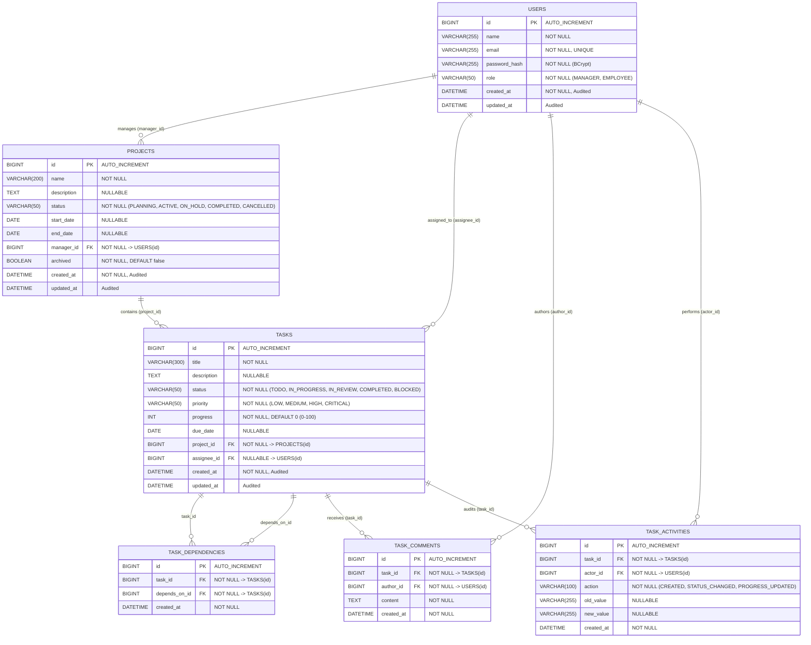

# Entity-Relationship (ER) Diagram & Schema Specification

> Comprehensive relational data model and Entity-Relationship diagram for **TaskFlow — AI-Powered Project Management System**.

---

## 1. Visual Entity-Relationship Diagram

---

## 2. Relational Schema Detailed Breakdown

### 2.1 Table: `users`
Represents software engineering team members and organizational administrators.

| Column | Type | Nullable | Constraints / Index | Description |
|---|---|:---:|---|---|
| `id` | `BIGINT` | No | `PRIMARY KEY`, `AUTO_INCREMENT` | Unique user identifier |
| `name` | `VARCHAR(255)` | No | | Full personal/display name |
| `email` | `VARCHAR(255)` | No | `UNIQUE INDEX` | Corporate login email |
| `password_hash` | `VARCHAR(255)` | No | | BCrypt one-way salted hash |
| `role` | `VARCHAR(50)` | No | Enum: `MANAGER`, `EMPLOYEE` | RBAC access level |
| `created_at` | `DATETIME` | No | JPA `@CreationTimestamp` | Account creation timestamp |
| `updated_at` | `DATETIME` | Yes | JPA `@UpdateTimestamp` | Last modification timestamp |

---

### 2.2 Table: `projects`
Represents strategic software engineering initiatives.

| Column | Type | Nullable | Constraints / Index | Description |
|---|---|:---:|---|---|
| `id` | `BIGINT` | No | `PRIMARY KEY`, `AUTO_INCREMENT` | Unique project identifier |
| `name` | `VARCHAR(200)` | No | | Project title |
| `description` | `TEXT` | Yes | | Architectural specifications & goals |
| `status` | `VARCHAR(50)` | No | Enum: `PLANNING`, `ACTIVE`, `ON_HOLD`, `COMPLETED`, `CANCELLED` | Current lifecycle state |
| `start_date` | `DATE` | Yes | | Target sprint start date |
| `end_date` | `DATE` | Yes | | Planned release delivery date |
| `manager_id` | `BIGINT` | No | `FOREIGN KEY (users.id)` | Lead engineer / project owner |
| `archived` | `BOOLEAN` | No | Default: `false` | Soft-deletion flag |
| `created_at` | `DATETIME` | No | JPA `@CreationTimestamp` | Record creation timestamp |
| `updated_at` | `DATETIME` | Yes | JPA `@UpdateTimestamp` | Last modification timestamp |

---

### 2.3 Table: `tasks`
Granular units of engineering work.

| Column | Type | Nullable | Constraints / Index | Description |
|---|---|:---:|---|---|
| `id` | `BIGINT` | No | `PRIMARY KEY`, `AUTO_INCREMENT` | Unique task identifier |
| `title` | `VARCHAR(300)` | No | | Deliverable summary |
| `description` | `TEXT` | Yes | | Implementation notes and acceptance criteria |
| `status` | `VARCHAR(50)` | No | Enum: `TODO`, `IN_PROGRESS`, `IN_REVIEW`, `COMPLETED`, `BLOCKED` | Kanban column status |
| `priority` | `VARCHAR(50)` | No | Enum: `LOW`, `MEDIUM`, `HIGH`, `CRITICAL` | Task urgency level |
| `progress` | `INT` | No | Range: `0` to `100`, Default: `0` | Completion percentage |
| `due_date` | `DATE` | Yes | | Deadline date |
| `project_id` | `BIGINT` | No | `FOREIGN KEY (projects.id)` | Parent project container |
| `assignee_id` | `BIGINT` | Yes | `FOREIGN KEY (users.id)` | Assigned software engineer |
| `created_at` | `DATETIME` | No | JPA `@CreationTimestamp` | Creation timestamp |
| `updated_at` | `DATETIME` | Yes | JPA `@UpdateTimestamp` | Modification timestamp |

---

### 2.4 Table: `task_dependencies`
Represents Directed Acyclic Graph (DAG) edges between tasks.

| Column | Type | Nullable | Constraints / Index | Description |
|---|---|:---:|---|---|
| `id` | `BIGINT` | No | `PRIMARY KEY`, `AUTO_INCREMENT` | Edge record identifier |
| `task_id` | `BIGINT` | No | `FOREIGN KEY (tasks.id)` | The dependent task |
| `depends_on_id` | `BIGINT` | No | `FOREIGN KEY (tasks.id)` | The prerequisite task |
| `created_at` | `DATETIME` | No | JPA `@CreationTimestamp` | Association timestamp |

*Unique Constraint*: `UNIQUE KEY (task_id, depends_on_id)` prevents redundant edge pairs.

---

### 2.5 Table: `task_comments`
Threaded technical discussions and status notes.

| Column | Type | Nullable | Constraints / Index | Description |
|---|---|:---:|---|---|
| `id` | `BIGINT` | No | `PRIMARY KEY`, `AUTO_INCREMENT` | Comment record identifier |
| `task_id` | `BIGINT` | No | `FOREIGN KEY (tasks.id)` | Associated task |
| `author_id` | `BIGINT` | No | `FOREIGN KEY (users.id)` | Authoring user |
| `content` | `TEXT` | No | | Comment text content |
| `created_at` | `DATETIME` | No | JPA `@CreationTimestamp` | Timestamp posted |

---

### 2.6 Table: `task_activities`
Immutable audit log recording every transition for compliance and activity streams.

| Column | Type | Nullable | Constraints / Index | Description |
|---|---|:---:|---|---|
| `id` | `BIGINT` | No | `PRIMARY KEY`, `AUTO_INCREMENT` | Audit record identifier |
| `task_id` | `BIGINT` | No | `FOREIGN KEY (tasks.id)` | Associated task |
| `actor_id` | `BIGINT` | No | `FOREIGN KEY (users.id)` | User performing the action |
| `action` | `VARCHAR(100)` | No | e.g. `CREATED`, `STATUS_CHANGED`, `PROGRESS_UPDATED` | Action type |
| `old_value` | `VARCHAR(255)` | Yes | | Previous state value |
| `new_value` | `VARCHAR(255)` | Yes | | New state value |
| `created_at` | `DATETIME` | No | JPA `@CreationTimestamp` | Event timestamp |
