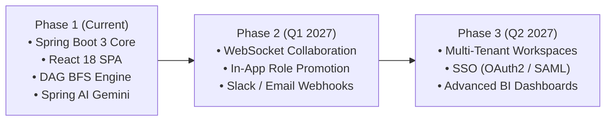

# Future Enhancements & Strategic Roadmap

> Strategic roadmap and planned architectural capabilities for **TaskFlow — AI-Powered Project Management System**.

---

## 1. Roadmap Overview

TaskFlow is architected with clear boundaries to support evolution into an enterprise-wide project management platform. The upcoming releases focus on real-time collaboration, expanded AI agent capabilities, and multi-tenant organization support.

---

## 2. Priority Enhancements

### 2.1 Real-Time WebSocket Collaboration (STOMP / SockJS)
- **Current State**: Client uses HTTP REST requests for updates; Kanban column updates require manual fetch or page refreshes.
- **Planned Capability**:
  - Integrate Spring WebSocket with STOMP message broker.
  - Broadcast live Kanban card drags, progress sliders, and comment postings to all team members viewing the project in real-time.
  - Display live collaborator avatars when multiple engineers are viewing the same task.

---

### 2.2 In-App Manager Promotion & Team Management UI
- **Current State**: Manager roles are assigned via code seeding (`DataInitializer.java`) or direct SQL commands to maintain enterprise security boundaries.
- **Planned Capability**:
  - Expose a secure `PATCH /api/users/{userId}/role` endpoint protected by `@PreAuthorize("hasRole('MANAGER')")`.
  - Add an interactive **"Promote to Manager"** button in the Team Directory UI, accompanied by an audit activity log entry recording who approved the elevation.

---

### 2.3 Automated Event-Driven Notifications (Email & Slack)
- **Current State**: Blockers and overdue deliverables are surfaced visually in the Manager and Employee dashboards.
- **Planned Capability**:
  - Add Spring Event listeners (`@EventListener` / `@Async`) for critical milestones.
  - Dispatch instant Slack webhook alerts when a task status transitions to `BLOCKED`.
  - Automated digest emails sent to project leads 48 hours prior to milestone deadlines.

---

### 2.4 Multi-Tenancy & Workspace Isolation
- **Current State**: Single organization tenancy with project-level access controls.
- **Planned Capability**:
  - Introduce an `organizations` / `workspaces` entity container.
  - Hibernate `@Filter` / schema-per-tenant isolation to allow multiple companies to use the same TaskFlow deployment with 100% data segregation.

---

### 2.5 Single Sign-On (SSO) & Social OAuth2
- **Current State**: Email and BCrypt password authentication with signed JWT.
- **Planned Capability**:
  - Integrate Spring Security OAuth2 Client for Google Workspace, GitHub Enterprise, and Okta SAML 2.0.
  - Auto-provision employee accounts based on verified corporate domain emails.

---

### 2.6 Advanced BI Analytics & Sprint PDF Reports
- **Current State**: Recharts-based completion and workload charts in React.
- **Planned Capability**:
  - One-click executive sprint PDF report generation using headless rendering.
  - Cycle time, lead time, and team velocity calculations (Burndown / Burnup charts).
