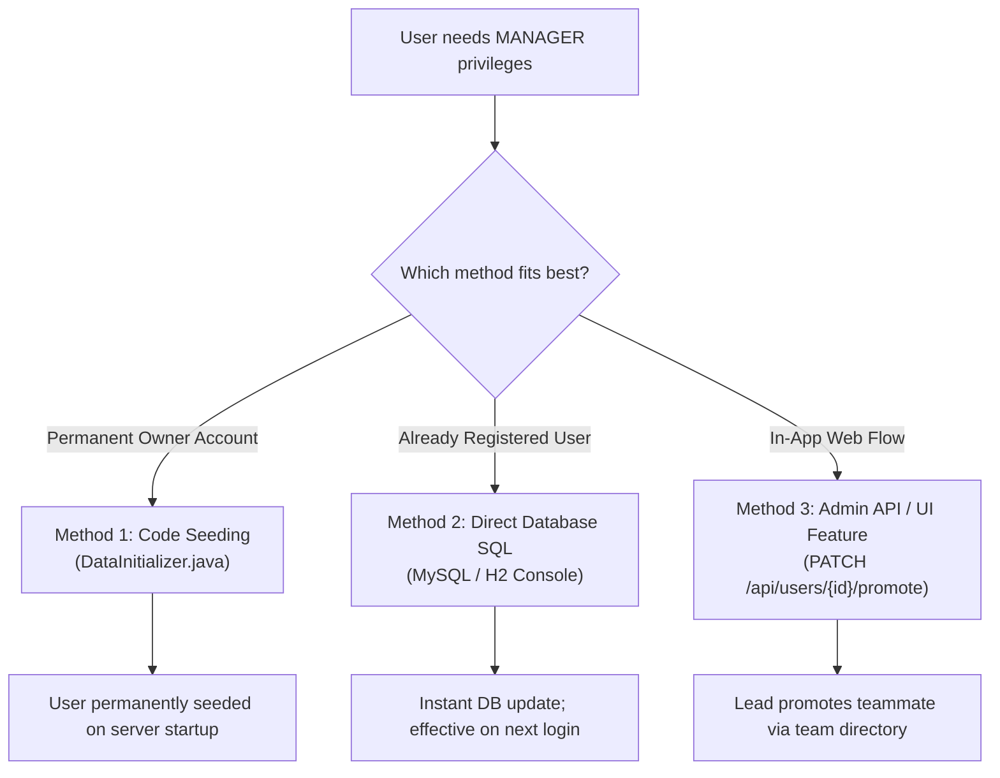

# SaaS Operational Setup & Administration Guide

> Multi-role access control, administration guidelines, and user management for **TaskFlow — AI-Powered Project Management System**.

---

## 1. Enterprise Security Principle: Why Sign Up Grants `EMPLOYEE` by Default

In standard enterprise SaaS platforms (e.g. Jira, Linear, GitHub Enterprise), allowing an open public `/register` form to assign `MANAGER` or `ADMIN` privileges introduces a severe vulnerability known as **Privilege Escalation**. Any external visitor could register an account and immediately:
- Delete or archive critical production projects.
- Reassign high-priority tasks and re-allocate sprint budgets.
- Approve AI generation plans without organizational oversight.

Therefore, in TaskFlow:
- Any self-registration via the public `/register` web form is **automatically assigned the `EMPLOYEE` role**.
- Elevating a user to **`MANAGER`** is strictly an administrative action.

---

## 2. Kisi ko Manager appoint kaise karein? (How to Appoint Someone as a Manager)

Depending on your deployment environment and workflow, there are **three reliable methods** to appoint a user as a Manager:



---

### Method 1: Automatic Startup Seeding in Code (Recommended for Project Owners)

If you want your personal account or a designated team lead to always be created as a Manager whenever the backend boots up:

1. Open [`backend/src/main/java/com/taskflow/config/DataInitializer.java`](file:///d:/Project%201/backend/src/main/java/com/taskflow/config/DataInitializer.java).
2. Inside `run(String... args)`, add your admin account:
```java
// Check if user already exists to avoid duplicates
if (!userRepository.existsByEmail("your.email@company.com")) {
    userRepository.save(User.builder()
            .name("Gaurav Kumar")
            .email("your.email@company.com")
            .passwordHash(passwordEncoder.encode("YourPassword123!"))
            .role(User.Role.MANAGER)  // <--- Appoints as MANAGER
            .build());
}
```
3. Commit and push to Git.
4. When the server restarts (or redeploys on Render), this user is permanently created with full Manager capabilities.

---

### Method 2: Direct SQL Query in Database

If the user has already signed up through the website and currently has an `EMPLOYEE` account in the database:

#### On Production MySQL / Cloud DB:
Connect to your database terminal and run:
```sql
UPDATE users 
SET role = 'MANAGER' 
WHERE email = 'user_email@example.com';
```

#### On Local H2 In-Memory Database:
1. Open [http://localhost:8080/h2-console](http://localhost:8080/h2-console) in your browser.
2. Connect with:
   - **JDBC URL**: `jdbc:h2:mem:taskflow_db`
   - **User Name**: `sa`
   - **Password**: *(leave blank)*
3. Execute the SQL command:
   ```sql
   UPDATE users SET role = 'MANAGER' WHERE email = 'user_email@example.com';
   ```
4. Have the user log out and log back in. Their newly issued JWT token will contain `"role": "MANAGER"`, unlocking the Manager dashboard and project controls immediately.

---

### Method 3: Via Role Promotion API (Future-Ready Team Administration)

To allow existing Managers to promote teammates directly through the web interface:

#### Backend Endpoint Implementation (`UserController.java`):
```java
@PatchMapping("/{userId}/promote")
@PreAuthorize("hasRole('MANAGER')") // Strictly restricted to existing Managers
public ResponseEntity<ApiResponse<Void>> promoteToManager(
        @PathVariable Long userId,
        @AuthenticationPrincipal UserDetails userDetails) {
    
    User user = userRepository.findById(userId)
            .orElseThrow(() -> new EntityNotFoundException("User not found with id: " + userId));
    
    user.setRole(User.Role.MANAGER);
    userRepository.save(user);
    
    return ResponseEntity.ok(ApiResponse.success("User successfully promoted to Manager", null));
}
```

#### UI Workflow:
1. An Engineering Lead opens the **Team Directory** page.
2. Next to each Product Engineer, a **"Promote to Manager"** action is available.
3. Clicking the button calls `PATCH /api/users/{id}/promote`.
4. The user's role is updated in the database, and their next session includes Manager permissions.

---

## 3. SaaS Role Capabilities Matrix

| Feature / Action | Engineering Lead (`MANAGER`) | Product Engineer (`EMPLOYEE`) |
|---|:---:|:---:|
| **Dashboard View** | Manager KPI Dashboard (Risks, Overdue, Initiatives) | Personal Sprint Dashboard (My Tasks, Deadlines) |
| **Create Projects** | **Yes** | No |
| **Edit / Archive Projects** | **Yes** | No |
| **Create & Delete Tasks** | **Yes** | No |
| **Assign Deliverables to Engineers** | **Yes** | No |
| **Update Task Status (`TODO` $\to$ `COMPLETED`)** | Yes | Yes (Assigned tasks) |
| **Update Progress Percentage (0–100%)** | Yes | Yes (Assigned tasks) |
| **Link Task Dependencies (DAG Edges)** | **Yes** | Read-Only |
| **Generate AI Work Breakdown Plan** | **Yes** | No |
| **Approve & Save AI Tasks to Sprint** | **Yes** | No |
| **Run Real-Time AI Risk Analysis** | Yes | Yes |
| **Generate Implementation Plan for a Task** | Yes | Yes |
| **Post Discussion Comments** | Yes | Yes |
| **View Audit Activity Stream** | Yes | Yes |

---

## 4. Cold-Start SLA & Operational Guarantees

Because the application is hosted on Render's free tier, keep in mind:
- **Idle Period**: The server spins down after 15 minutes of zero traffic.
- **Wakeup Time**: The first request takes approximately **35–50 seconds** to boot Spring Boot and initialize the in-memory database.
- **Client Configuration**: The frontend Axios client is configured with a **90-second timeout** to ensure it never prematurely cancels a wake-up request.
- **Warm Performance**: Once awake, REST requests are processed in **under 2.5 seconds**.
