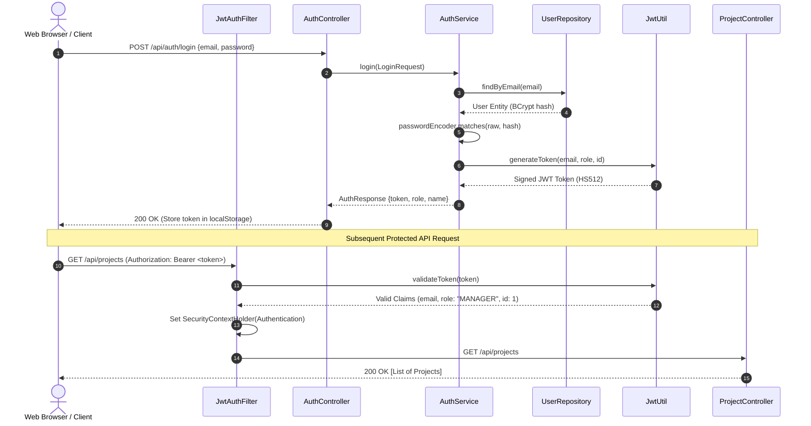
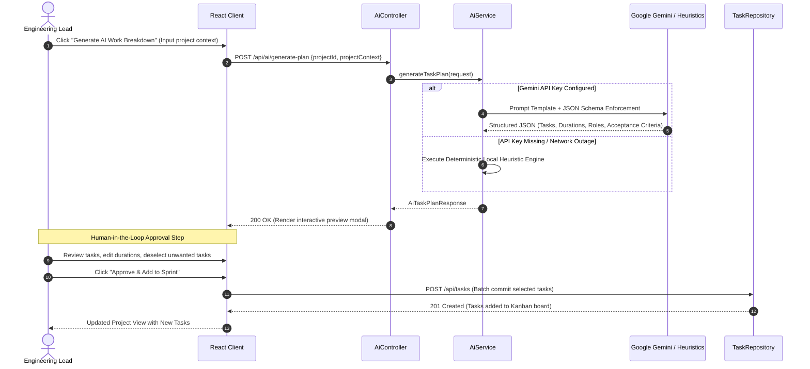
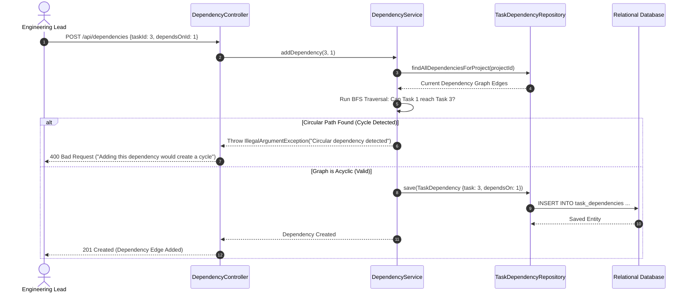

# System Sequence Diagrams

> Sequence diagrams illustrating end-to-end communication flows across client, backend, database, and AI components in **TaskFlow — AI-Powered Project Management System**.

---

## 1. Authentication & JWT Authorization Flow

Illustrates user credential authentication, token generation, and subsequent authorized API requests.



---

## 2. AI Work Breakdown Generation & Human-in-the-Loop Review Flow

Illustrates how an Engineering Lead enters project context, receives structured AI task recommendations, reviews them, and commits them to the database.



---

## 3. Task Dependency Creation & BFS Cycle Detection Flow

Illustrates how the Directed Acyclic Graph (DAG) cycle detection algorithm prevents dependency deadlocks.



---

## 4. Task State Transition & Audit Activity Recording Flow

Illustrates an engineer updating a task status on the Kanban board and the automatic generation of an immutable compliance audit record.

```mermaid
sequenceDiagram
    autonumber
    actor Engineer as Product Engineer
    participant Frontend as Kanban Board
    participant TaskCtrl as TaskController
    participant TaskSvc as TaskService
    participant TaskRepo as TaskRepository
    participant ActRepo as TaskActivityRepository
    participant DB as Relational Database

    Engineer->>Frontend: Drag Task from "IN_PROGRESS" to "COMPLETED"
    Frontend->>TaskCtrl: PATCH /api/tasks/4/status {status: "COMPLETED", progress: 100}
    TaskCtrl->>TaskSvc: updateTaskStatus(4, request, currentUser)
    TaskSvc->>TaskRepo: findById(4)
    TaskRepo-->>TaskSvc: Task Entity (Old Status: "IN_PROGRESS")
    
    TaskSvc->>TaskSvc: task.setStatus("COMPLETED"); task.setProgress(100);
    TaskSvc->>TaskRepo: save(task)
    TaskRepo->>DB: UPDATE tasks SET status='COMPLETED', progress=100 WHERE id=4
    
    Note over TaskSvc,ActRepo: Automatic Immutable Audit Logging
    TaskSvc->>ActRepo: save(TaskActivity {task: 4, actor: currentUser, action: "STATUS_CHANGED", old: "IN_PROGRESS", new: "COMPLETED"})
    ActRepo->>DB: INSERT INTO task_activities ...
    
    TaskSvc-->>TaskCtrl: Updated Task DTO
    TaskCtrl-->>Frontend: 200 OK (Refresh Kanban card & activity feed)
    Frontend-->>Engineer: Visual confirmation & completed badge
```
